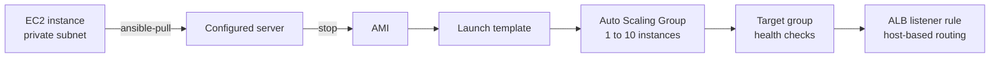

# terraform-aws-roboshop

Reusable Terraform module that deploys one RoboShop service as a **self-healing, auto-scaling** group of EC2 instances behind an Application Load Balancer. The same module deploys every service (catalogue, user, cart, shipping, payment and frontend), so adding a service is one more entry in a map.

Used by [roboshop-infra-dev](https://github.com/prudhvisaikoppaka/roboshop-infra-dev) in the `80-user` and `90-components` stacks.

## How it works



1. **Build:** launches a temporary EC2 instance and runs a bootstrap script that installs Ansible and runs `ansible-pull` with the service's role from [ansible-roboshop-roles-tf](https://github.com/prudhvisaikoppaka/ansible-roboshop-roles-tf).
2. **Bake:** stops the instance and creates an AMI from it, then deletes the temporary instance.
3. **Run:** creates a launch template from the AMI and an Auto Scaling Group across the private subnets.
4. **Scale:** target tracking policy keeps average CPU at 75%.
5. **Update:** a new AMI triggers a **rolling instance refresh** with at least 50% of instances healthy.
6. **Route:** creates a target group with health checks and a host-based listener rule:
   - frontend: `dev.<domain>` on the public ALB, port 80, health check `/`
   - backend services: `<service>.backend-dev.<domain>` on the internal ALB, port 8080, health check `/health`

Shared values (VPC ID, subnet IDs, security group IDs, listener ARNs) are read from **SSM Parameter Store**, so the module needs only a service name and a rule priority.

## Usage

```hcl
module "component" {
  for_each = {
    catalogue = { rule_priority = 10 }
    user      = { rule_priority = 20 }
    cart      = { rule_priority = 30 }
    shipping  = { rule_priority = 40 }
    payment   = { rule_priority = 50 }
    frontend  = { rule_priority = 10 }
  }

  source        = "git::https://github.com/prudhvisaikoppaka/terraform-aws-roboshop.git?ref=main"
  component     = each.key
  rule_priority = each.value.rule_priority
}
```

## Inputs

| Name | Default | Required | Description |
|---|---|---|---|
| `component` | | yes | Service name, for example `catalogue` |
| `rule_priority` | | yes | Priority of the ALB listener rule, unique per load balancer |
| `project` | `roboshop` | no | Project name |
| `environment` | `dev` | no | Environment name |
| `zone_id` | | no | Route 53 hosted zone ID |
| `zone_name` | | no | Domain name used for routing |

## Resources created

`aws_instance`, `terraform_data` (provisioning and cleanup), `aws_ec2_instance_state`, `aws_ami_from_instance`, `aws_launch_template`, `aws_autoscaling_group`, `aws_autoscaling_policy`, `aws_lb_target_group`, `aws_lb_listener_rule`

## Requirements

- Terraform 1.x, AWS provider 6.x
- The SSM parameters written by the `00-vpc`, `10-sg`, `50-backend-alb` and `70-frontend-alb` stacks of [roboshop-infra-dev](https://github.com/prudhvisaikoppaka/roboshop-infra-dev)

## Next steps

- Use SSH keys and AWS Secrets Manager instead of password authentication in the provisioner
- Build AMIs with Packer instead of from a running instance
